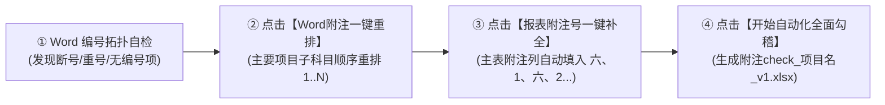

# 财务报表附注自动化勾稽与编号治理系统 · 完整操作指南

## 一、 系统定位与核心审计原则

本系统专为注册会计师及审计项目组打造，旨在实现从 **Word文字报告**、**Excel财务报表** 到 **TB试算平衡表底稿** 的全链路自动化核对与编号治理。

### 1. 核心审计三大原则
* **原则一：对外披露一致性为绝对第一优先级（报表 ↔ 附注）**
  * 财务报表与附注是对外公布的法定披露文件，报表主表每个项目的期末/期初金额，与附注对应小节的期末/期初合计数必须 100% 严密公式勾稽。
  * 勾稽公式直接写入生成表格的右侧区域（如 `=报表!E7 - 附注!B11`），差异实时变色提醒。
* **原则二：底稿（TB）作为报表未展开明细的精准对齐工具**
  * 报表 90% 以上已经公式链接 TB，对外报表是最终口径。
  * **克制核对边界**：不将整套附注盲目与 TB 对齐，仅针对对外报表未单独体现颗粒度、但附注详细展开的深层明细（最典型的为：**现金流量表补充资料**中净利润调节各项、现金及等价物变动、银行存款明细、受限资产等），与 TB 底稿（`CF-Indirect` / `CF-Direct` 的 `A.A` 审定数列）进行 1 对 1 逐格核对，做到底稿严密闭环，又绝不产生无关噪音。
* **原则三：单体公司 vs 合并集团双轨自适应**
  * **单体公司**：仅有一套报表和附注，母公司轨自动静默关闭，不产生任何误报。
  * **合并集团**：自动启动双轨核对模式：
    * **合并轨**：合并附注主要项目 ↔ 合并资产负债表、合并利润表、合并现金流量表；
    * **母公司轨**：母公司附注主要项目（母公司应收账款、母公司长投、母公司营业收入成本等） ↔ 母公司资产负债表、母公司利润表。

---

## 二、 附注编号全自动闭环治理

针对附注编制过程中最繁琐的“跳号、重号、漏号、报表附注列空白或错位”痛点，系统提供全自动闭环解决：

### 1. Word 附注主要项目编号诊断与一键重排
* **智能双重锚点识别**：不仅识别带数字的前缀（如 `1、货币资金`），还内置 80+ 个标准会计科目语义库。哪怕某个科目漏打了编号（如直接写 `研发费用`），系统依然能精准捕获，绝不漏掉。
* **诊断报警**：实时提示跳号（如 `期望为4，实际为5`）、重号（如 `出现两个5`）、以及未编号科目（如 `科目【研发费用】未填写序号`）。
* **一键顺序重编号**：严格限定在《主要项目附注》及《母公司主要项目附注》范围，保持原字体、字号、排版格式，将子科目重新按 `1、`、`2、`、`3、` ... $N$ 严格顺序重编，输出规范副本。

### 2. 报表附注号一键修复与补全
* **大标题智能匹配**：自动提取附注大标题中文字符（如《六、财务报表主要项目附注》提取前缀 `六、`；母公司提取 `十八、`），保证大标题与序号同时匹配。
* **一键回填**：自动扫描报表主表（资产负债表、利润表、现金流量表等）的项目列与附注列。
  * **空白项**：自动补全为规范编号（如 `六、1`）；
  * **错号项**：自动修正为最新对应的附注号；
  * **非附注小计/合计**：保持空白，避免乱填。

---

## 三、 独立运行程序交付物 (`.exe`)

系统已完整编译为 Windows 单一免安装可执行程序：
* **程序路径**：[`财务报表附注自动化勾稽系统.exe`](file:///d:/Antigravity/附注check/财务报表附注自动化勾稽系统.exe)
* **运行环境**：任何 Windows 64位操作系统（Windows 10 / 11 / Server），无需预装 Python。

### 界面操作步骤
1. **双击启动** `财务报表附注自动化勾稽系统.exe`；
2. **选择提交文件**：
   * `1. 报告附注`：选择 Word `.doc` / `.docx` 或 Excel 提取件；
   * `2. 财务报表`：选择包含资产负债表、利润表、现金流量表的 Excel 文件；
   * `3. TB试算表`：选择包含 `CF-Direct` / `CF-Indirect` 的审定工作底稿；
3. **常用操作（按需点击）**：
   * 若需修正附注编号：点击 **【📝 Word附注编号诊断与重排】**；
   * 若需补齐报表附注列：点击 **【📊 报表附注号一键修复补全】**；
   * 开始全面勾稽：点击 **【▶ 开始自动化全面勾稽 (生成Check表)】**；
4. **自动归档与版本递增**：
   * 系统自动提取项目名称（如 `铁联化轻`），并在归档目录下建立专用二级文件夹；
   * 自动归档提交的三份原始文件；
   * 自动生成勾稽成果：`附注check_项目名_v1.xlsx`；
   * 若后续数据更新再次运行，成果文件自动升级为 `v2`、`v3`，历史所有版本永久保留，绝不覆盖；
   * 运行结束后点击 **【📁 打开项目归档文件夹】** 即可直接查验成果。
